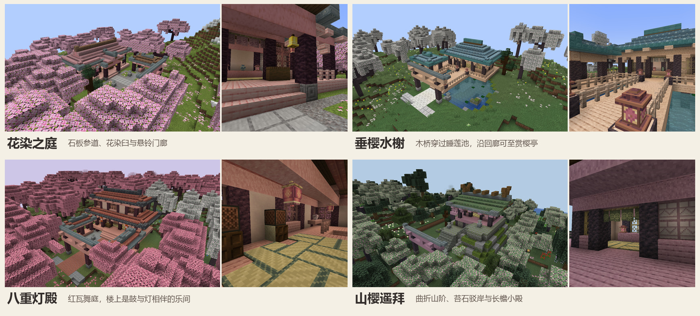
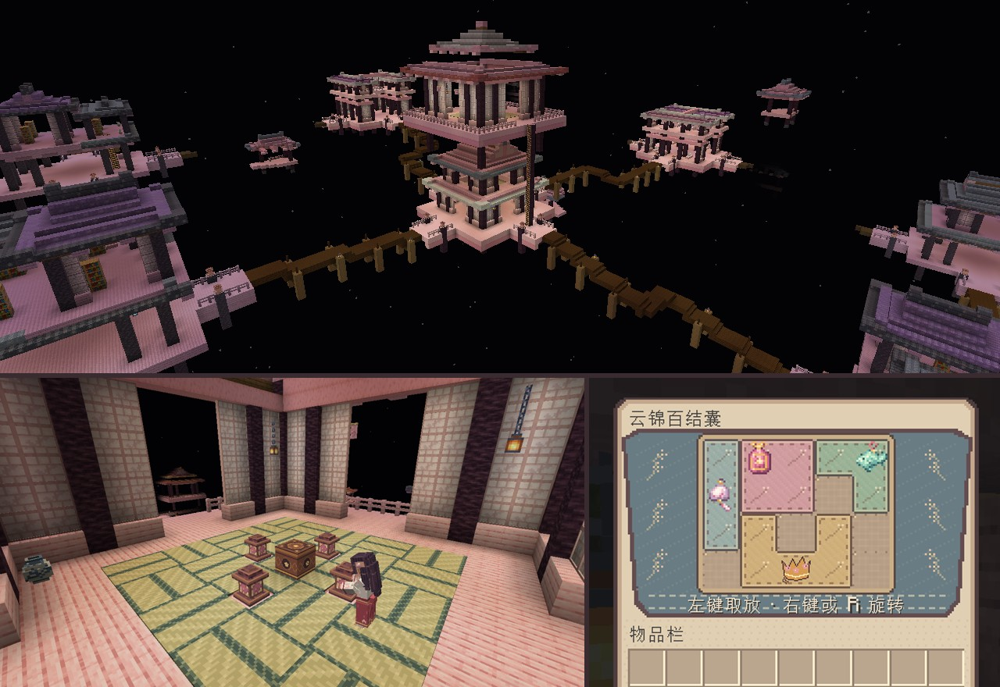

# 落樱缤纷（Sakura Bloom）

落樱缤纷为主世界添加枝垂樱、八重樱和山樱。三种樱树各有对应的群系，也会零星出现在原版樱花树林中。玩家能在林间找到使用当地木材的神社，也能带回树苗，取材制作障子、花格窗和木箱。夜巡樱林获得的樱札可以带去神社祈愿。完成巫女委托后，玩家还能持红枫扇进入永夜的隙间，沿桥探索分殿并挑战守护者。

[下载主体与「食事」附属](https://github.com/ciallo555/sakura-bloom/releases/latest)

| 条目资料 | 内容 |
| --- | --- |
| 模组 ID | `sakura_bloom` |
| 适用版本 | 模组 0.9.1，Minecraft Java 版 1.21.1，NeoForge 21.1.267 |
| 建议主要元素 | 装饰、探索、冒险 |
| 安装环境 | 客户端和服务端均安装主体及前置模组 [TerraBlender 4.1.0.8](https://modrinth.com/mod/terrablender/version/6e8GCrLb)。 |
| 可选内容 | Curios 提供旅饰栏位，FTB Chunks 按树种显示樱林冠色，JEI 可查询花染臼配方及赛钱箱各项奖励的概率。作物、厨具和料理由附属[落樱缤纷 · 食事](/docs/mcmod/食事.md)添加。 |

## 樱林与神社

神社有机会出现在四种樱林新生成的区块中。鸟居前的参道与当地地面相接，平地铺石，遇到落差时留出台阶。沿路入内，可以见到花庭、池上木桥或山阶。神社与林间建筑都会挑选干燥、坡度合适的场地，并避开废弃传送门。

| 群系 | 神社 | 游戏中如何辨认 |
| --- | --- | --- |
| 樱花树林（原版） | 花染之庭 | 花圃夹着石板参道。参道旁的净手亭里可以研磨花瓣，正面的粉瓦拜殿另有一重门廊，廊下悬铃。 |
| 枝垂樱野 | 垂樱水榭 | 鸟居正对池上的直木桥。桥尽头的外廊通向拜殿和赏樱亭，亭内有临水长凳。池底的沙砾与黏土随深浅成片分布。 |
| 八重樱丘 | 八重灯殿 | 两侧挂着朱纱宫灯的回廊围出一方舞庭。舞台背后是双层红瓦殿，沿殿内贴柱的梯子可登上花格窗围起的乐间，室内陈设着鼓、朱纱宫灯和一只靠墙的奖励箱。 |
| 山樱杂木林 | 山樱遥拜 | 第一段石阶直上，在石灯处转过直角，再登第二段。台顶小殿向前伸出长檐，屋脊两端有交叉木饰，旁边是眺望山林的木台。 |

配图来自自然生成的游戏世界。在启用了命令的世界中，`/locate structure #sakura_bloom:shrines` 可定位最近的一座神社。

## 林间建筑与旅饰

| 建筑 | 生成群系 | 在哪里找箱子 | 箱中可能出现的饰品 |
| --- | --- | --- | --- |
| 花染作坊 | 繁花森林、樱花树林、八重樱丘 | 掀开蓝白门帘，一楼织布机旁的箱子贴着后墙。沿店内贴墙的梯子可到二楼的裁布台和布卷架，沿土间可到后院的染槽与晾布架。 | 八重花结御守较常见，也可能是枝垂风铃坠。 |
| 听雨歇亭 | 草甸、樱花树林、枝垂樱野 | 从竹制候座沿踏石绕过净手池，进入茶室。箱子靠在榻榻米尽头的后墙，外侧木廊通往池上。 | 青瓷游鱼佩、枝垂风铃坠，两者机会相同。 |
| 山樱木作寮 | 森林、桦木森林、山樱杂木林 | 经过起料架进入工房，沿后墙的梯子登上木阁。奖励箱在后墙边，旁边摆着样木和制图台。 | 山樱墨绳腕结较常见，也可能是八重花结御守。 |

每个奖励箱都能开出面包、火把、铁粒等补给中的几样，还有当地的花瓣、竹篾或木料。三处新建筑的箱子各有 **35%** 的概率额外开出一件饰品。四种神社也各有一个奖励箱，饰品概率为 **25%**，四款机会相同。已有存档可以到新生成的区块探索，或用 `/locate structure #sakura_bloom:woodland_landmarks` 寻找最近的林间建筑。

| 饰品 | Curios 栏位 | 佩戴效果 |
| --- | --- | --- |
| 枝垂风铃坠 | 腰带 | 移动速度 +15%，免疫摔落伤害。 |
| 八重花结御守 | 护符 | 最大生命值 +4（两颗心）。每次进食后获得 5 秒生命回复 I。 |
| 青瓷游鱼佩 | 项链 | 在水中时，移动速度和挖掘速度均增加 30%，并获得水下呼吸 I。 |
| 山樱墨绳腕结 | 手镯 | 佩戴时获得急迫 II。 |

安装 Curios 后，将旅饰戴在对应栏位，或收进佩戴于腰带栏的锦囊，即可获得效果。不同旅饰可同时生效，同款只计一次。

建筑设计借鉴了村镇模组按地域和用途区分房舍的做法。视频参考包括神社的拜殿、日本庭园的水岸，以及 SOU 茶屋的门帘与缘侧。[Towns and Towers](https://modrinth.com/mod/towns-and-towers) · [ChoiceTheorem’s Overhauled Village](https://modrinth.com/mod/ct-overhaul-village) · [神社を作る](https://dekiru.net/article/25157/) · [日本庭園を作る](https://dekiru.net/article/25161/) · [SOU 的小茶屋](https://minecraft-log.com/1480)

## 樱林夜巡与隙间

夜间可在四种樱林的林下和开阔地遇到暮影狐、墨鬃狼和晦月兔。三种妖怪的生成权重相同，生成处的方块光照须为 7 或更低。神社周围 64 格受到庇护。击败妖怪可获得樱札。守樱巫女白天在神社附近活动，夜里会回到殿内的赛钱箱前祈祷。创造模式中，三种妖怪、守樱巫女、引灯灵和巡殿傀各有对应的刷怪蛋。

- **祈祷**　四座神社的赛钱箱都设在拜殿中央。手持樱札右键投入一张，再空手右键祈祷，每次获得一种奖励。JEI 可以查看当前奖励物品、数量和概率。默认奖励包括蜂蜜瓶、经验瓶、紫水晶碎片等，四件主世界旅饰各占 1/66。
- **交易与委托**　空手与巫女交谈，再交谈一次接取当前委托。潜行或手持樱札与她交互可交易。每轮委托依次为交付 12 张纸、击败 3 只妖怪、交付 4 个墨囊和 3 个紫水晶碎片。每项奖励 4 张樱札，完成整轮再获红枫叶扇「神隐」。
- **锦囊**　百结锦囊有 4×3 格，可合成或向巫女购买。云锦百结囊有 5×4 格，藏在部分隙间街区建筑的箱子里。手持锦囊右键打开，拿起旅饰后可用右键或 R 键旋转，左键嵌入绣格。饰品形状各异，需要为它们留出连在一起的空格。
- **往返**　挥动红枫叶扇「神隐」进入永夜的隙间，再挥一次返回出发处。花楼、船坞和藏阁散落在高低错落的空岛上，岛与岛之间有悬桥，也有断开的屋檐和向下伸出的木台。失足落入虚空会回到个人重生点。

| 隙间群系 | 自然居民 | 分殿与守护者 | 地方材料 | 当地旅饰 |
| --- | --- | --- | --- | --- |
| 灯市花楼 | 友好 | 百灯奉花殿 · 万灯司 | 灯芯琥珀 | 百灯花冠 |
| 月泊船津 | 友好与敌对 | 泊月舷宫 · 渡月舟师 | 月潮螺片 | 潮音珠 |
| 朱桥回廊 | 友好与敌对 | 朱桥鸣钟殿 · 朱梁角将 | 朱漆鳞 | 百战锦结 |
| 灰烬重阁 | 敌对 | 藏烬书阁 · 灰羽镜主 | 灰羽晶 | 照夜镜 |

部分街区建筑的靠墙箱子里有面包和樱札，还有 25% 的机会开出对应旅饰、22% 的机会开出云锦百结囊。降灵印所需材料来自战斗。在隙间击败模组敌对生物可获得当地材料。灯市以外的暮影狐还会额外掉落灯芯琥珀。

将一张樱札放在工作台中央，上下左右各放一份当地材料，制成对应的降灵印。到该群系的分殿，双手空着右键点亮祭台四方的花见灯，再持印右键中央祭台即可召唤守护者。

守护者蓄力时，地面的粒子会标出攻击范围。万灯司点燃火环，舟师在目标脚下唤起月潮，角将沿桥直击，镜主画出十字灰焰。战胜守护者会得到该殿的武器和核心材料。核心可制成对应旅饰，也可在锻造台以当地材料为模板、用核心强化钻石剑并保留附魔。降灵殿与守护者的设计参考了地牢中有独立首领房和战利品的冒险结构。[The Aether · 青铜地牢](https://aether.wiki.gg/wiki/The_Aether/Bronze_Dungeon)

## 樱木与庭院木作

每种樱木都能制成木板、楼梯、门、告示牌、悬挂式告示牌和船，也有对应的木箱。在工作台中央放一个铁粒，周围放八块同种樱木板，可制成一个木箱。两个同种木箱并排可拼成大箱子。

障子有 14 款，分别使用 11 种原版木材（含竹板和两种下界木板）以及三种模组樱木。花格窗共有 19 款，其中 14 款的镂空纹样由木材决定。例如，白桦木做成龟甲花格窗，枝垂樱木做成垂枝花格窗，八重樱木做成重瓣花格窗，山樱木做成远山花格窗。另外五款为海棠、回纹、冰裂、菱花和步步锦。

**龟甲花格窗的做法**　在工作台横放两根竹子，得到四份竹篾。四角放白桦木板，四边中间放竹篾，中央留空，一次得到四扇。把四角换成另一种同种木板，即可制作相应纹样。

门帘有 16 色，可以挂在门楣下，玩家可从中穿过。筒瓦也有 16 色，各有自己的瓦面和瓦当纹样。同色整瓦可在切石机上加工成楼梯或台阶，用来铺坡屋顶和收边。室内还可铺设包边榻榻米、悬挂朱纱宫灯或摆放折枝瓶。

## 花染与照明

手持花瓣右键花染臼，每份花瓣可磨出两份染料。枝垂樱花瓣出白色染料，八重樱出红色，山樱出品红色。部分原版花材也能研磨，例如一朵虞美人可以磨出两份红色染料。

双手空着时右键花见灯可以开关灯光，也可用红石信号点亮。点亮时亮度等级为 14。

---

*作者参考稿，按 0.9.1 发行文件整理，含 AI 辅助撰写。MC 百科对公共编辑中的 AI 生成文字有限制，站内正文请由作者依据实测自行撰写。[站方公告](https://bbs.mcmod.cn/thread-20183-1-1.html)*
