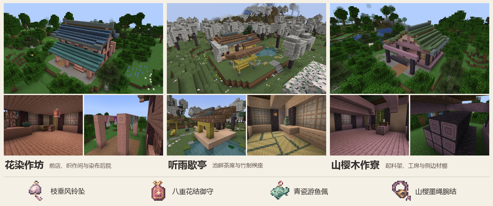

# 落樱缤纷（Sakura Bloom）

落樱缤纷为主世界添加枝垂樱、八重樱和山樱。三种樱树各有对应的群系，也会零星出现在原版樱花树林中。玩家能在林间找到使用当地木材的神社，也能带回树苗，取材制作障子、花格窗和木箱。

[下载主体与「食事」附属](https://github.com/ciallo555/sakura-bloom/releases/latest)

| 条目资料 | 内容 |
| --- | --- |
| 模组 ID | `sakura_bloom` |
| 适用版本 | 模组 0.8.6，Minecraft Java 版 1.21.1，NeoForge 21.1.267 |
| 建议主要元素 | 装饰 |
| 安装环境 | 客户端和服务端均安装主体及前置模组 [TerraBlender 4.1.0.8](https://modrinth.com/mod/terrablender/version/6e8GCrLb)。 |
| 可选内容 | Curios 提供护符栏，JEI 可查询花染臼的研磨配方。作物、厨具和料理由附属[落樱缤纷 · 食事](/docs/mcmod/食事.md)添加。 |

## 樱林与神社

神社有机会出现在四种樱林新生成的区块中。沿鸟居前的两级石阶入内，参道会随当地地形和神社样式转为花庭、折桥或山阶。神社与林间建筑都会挑选干燥、坡度合适的场地，并避开废弃传送门。

| 群系 | 神社匾额 | 游戏中如何辨认 |
| --- | --- | --- |
| 樱花树林（原版） | 花染之庭 | 花圃夹着石板参道。参道旁的净手亭里可以研磨花瓣，正面的粉瓦拜殿另有一重门廊，廊下悬铃。 |
| 枝垂樱野 | 垂樱水榭 | 木桥在睡莲池中折了两个弯，一头接鸟居，一头接淡蓝瓦的水榭。沿外廊绕过拜亭，可以走到独立的小观景台。 |
| 八重樱丘 | 八重灯殿 | 两侧挂着朱纱宫灯的回廊围出一方舞庭。舞台背后是双层红瓦殿，两重屋檐之间镶着花格窗。 |
| 山樱杂木林 | 山樱遥拜 | 第一段石阶直上，在石灯处转过直角，再登第二段。台顶小殿向前伸出长檐，屋脊两端有交叉木饰，旁边是眺望山林的木台。 |

配图来自自然生成的游戏世界。在启用了命令的世界中，`/locate structure #sakura_bloom:shrines` 可定位最近的一座神社。

## 林间建筑与旅饰

| 建筑 | 生成群系 | 在哪里找箱子 | 箱中可能出现的饰品 |
| --- | --- | --- | --- |
| 花染作坊 | 繁花森林、樱花树林、八重樱丘 | 掀开町家店面的蓝白门帘，箱子在一楼织布机旁。侧面的土间直通后院，能看到染缸和晾着花纹布匹的横架。 | 八重花结御守较常见，也可能是枝垂风铃坠。 |
| 听雨歇亭 | 草甸、樱花树林、枝垂樱野 | 从竹制候座沿踏石绕过水钵，进入茶室。箱子在榻榻米一侧，沿木廊可以走到池上。 | 青瓷游鱼佩、枝垂风铃坠，两者机会相同。 |
| 山樱木作寮 | 森林、桦木森林、山樱杂木林 | 经过吊着原木的起料架进入工房，箱子在切石机和工作台旁。侧棚堆放木料，后墙的梯子通往储料阁。 | 山樱墨绳腕结较常见，也可能是八重花结御守。 |

每个奖励箱都能开出面包、火把、铁粒等补给中的几样，还有当地的花瓣、竹篾或木料。三处新建筑的箱子各有 **35%** 的概率额外开出一件饰品。四种神社也各有一个奖励箱，饰品概率为 **25%**，四款机会相同。已有存档可以到新生成的区块探索，或用 `/locate structure #sakura_bloom:woodland_landmarks` 寻找最近的林间建筑。

| 饰品 | 佩戴效果 |
| --- | --- |
| 枝垂风铃坠 | 落地响铃，飘落浅色樱瓣，计算摔落伤害时少算 3 格。 |
| 八重花结御守 | 受伤时吃完食物额外恢复 1 颗心，每 45 秒可触发一次。 |
| 青瓷游鱼佩 | 潜水时气泡消耗减半。 |
| 山樱墨绳腕结 | 用斧采掘适合用斧的方块时提速 20%。采掘原版及三种变种樱树的原木、木头或其去皮变种时提速 35%。 |

饰品放入副手即可生效。装有 Curios 时也可以戴在护符栏，腾出副手拿盾或火把。同款饰品只生效一次。

建筑设计借鉴了村镇模组按地域和用途区分房舍的做法。视频参考包括神社的拜殿、日本庭园的水岸，以及 SOU 茶屋的门帘与缘侧。[Towns and Towers](https://modrinth.com/mod/towns-and-towers) · [ChoiceTheorem’s Overhauled Village](https://modrinth.com/mod/ct-overhaul-village) · [神社を作る](https://dekiru.net/article/25157/) · [日本庭園を作る](https://dekiru.net/article/25161/) · [SOU 的小茶屋](https://minecraft-log.com/1480)

## 樱木与庭院木作

每种樱木都能制成木板、楼梯、门、告示牌、悬挂式告示牌和船，也有对应的木箱。在工作台中央放一个铁粒，周围放八块同种樱木板，可制成一个木箱。两个同种木箱并排可拼成大箱子。

障子有 14 款，分别使用 11 种原版木材（含竹板和两种下界木板）以及三种模组樱木。花格窗共有 19 款，其中 14 款的镂空纹样由木材决定。例如，白桦木做成龟甲花格窗，枝垂樱木做成垂枝花格窗，八重樱木做成重瓣花格窗，山樱木做成远山花格窗。另外五款为海棠、回纹、冰裂、菱花和步步锦。

**龟甲花格窗的做法**　在工作台横放两根竹子，得到四份竹篾。四角放白桦木板，四边中间放竹篾，中央留空，一次得到四扇。把四角换成另一种同种木板，即可制作相应纹样。

门帘有 16 色，可以挂在门楣下，玩家可从中穿过。筒瓦也有 16 色，各有自己的瓦面和瓦当纹样。同色整瓦可在切石机上加工成楼梯或台阶，用来铺坡屋顶和收边。室内还可铺设包边榻榻米、悬挂朱纱宫灯或摆放折枝瓶。

## 花染与照明

手持花瓣右键花染臼，每份花瓣可磨出两份染料。枝垂樱花瓣出白色染料，八重樱出红色，山樱出品红色。部分原版花材也能研磨，例如一朵虞美人可以磨出两份红色染料。

双手空着时右键花见灯可以开关灯光，也可用红石信号点亮。点亮时亮度等级为 14。

---

*作者参考稿，按 0.8.6 发行文件整理，含 AI 辅助撰写。MC 百科对公共编辑中的 AI 生成文字有限制，站内正文请由作者依据实测自行撰写。[站方公告](https://bbs.mcmod.cn/thread-20183-1-1.html)*
