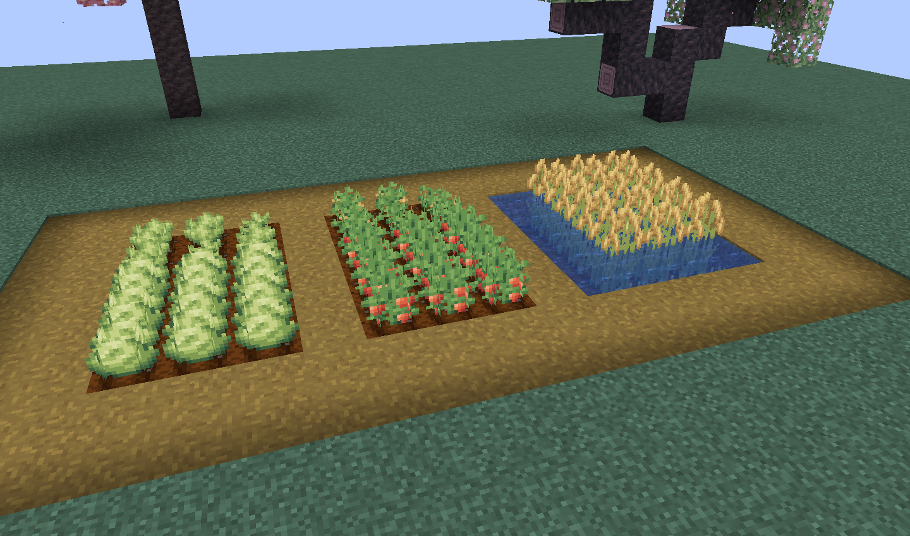
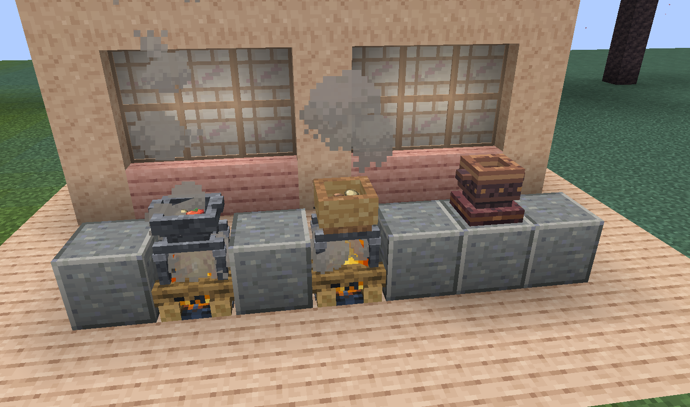

# 落樱缤纷 · 食事（Sakura Bloom · Cuisine）

食事是[落樱缤纷](./落樱缤纷.md)的可选农业附属。它把三种樱树的花瓣用作茶料，还添加卷心菜、番茄、水稻，以及可以看见食材和成品的炒锅与蒸笼。

| 条目资料 | 内容 |
| --- | --- |
| 模组 ID | `sakura_bloom_cuisine` |
| 适用版本 | 模组 0.9.0，Minecraft Java 版 1.21.1，NeoForge 21.1.267 |
| 建议主要元素 | 农业 |
| 前置与环境 | 客户端和服务端均安装食事、落樱缤纷主体及主体所需的 TerraBlender。 |
| 可选联动 | 农夫乐事（Farmer’s Delight）、森罗物语《厨房》（Kaleidoscope Cookery）、JEI |

## 作物从哪里来

| 作物 | 种子来源 | 栽培方式 |
| --- | --- | --- |
| 卷心菜 | 沙滩群系中的野生卷心菜；新生成的原版村庄农田中也有机会找到卷心菜。 | 在普通耕地播种，农民村民也会种植和收获。 |
| 番茄 | 新生成的原版村庄农田中有机会出现番茄，可从成熟植株收获种子。 | 在普通耕地播种，农民村民也会种植和收获。 |
| 水稻 | 河流群系的浅水边缘有机会长出野生水稻。其下是泥土，植株下半部浸在一格深的水源中。 | 先把耕地正上方一格灌成水源，再将稻种种在这格水里。水源上方留空，成熟时稻穗从水面再长出一格，全株高两格。 |

收稻时可以打掉稻穗或下半株，收获后水源会留在田里，可以原地播种。

## 炒锅、蒸笼与盛菜

将炒锅或蒸笼放在点燃的营火正上方，锅底会显示支架。手持食材逐个右键投入，锅里会显示已经放入的食材。双手空着右键开始烹饪。开火前潜行并空手右键可以取回原料；烹饪中热源熄灭，进度会暂停。

碗在菜做好后使用。以茶碗蒸为例，先往蒸笼放一个鸡蛋和一个棕色蘑菇，空手右键开蒸，做好后再手持空碗右键盛出。鲑鱼饭团和卷心菜蒸肉卷可以直接空手取出。

食事自带以下七道基础菜谱，每种所列食材各用一份。

| 厨具 | 菜品 | 食材 | 取餐 |
| --- | --- | --- | --- |
| 蒸笼 | 蒸米饭 | 稻米 | 碗 |
| 蒸笼 | 鲑鱼饭团 | 稻米、干海带、熟鲑鱼 | 空手 |
| 蒸笼 | 茶碗蒸 | 鸡蛋、棕色蘑菇 | 碗 |
| 蒸笼 | 卷心菜蒸肉卷 | 卷心菜、生肉、稻米 | 空手 |
| 炒锅 | 日式炒面 | 生面条、卷心菜、生肉 | 碗 |
| 炒锅 | 番茄炒蛋 | 番茄、鸡蛋 | 碗 |
| 炒锅 | 蛋炒饭 | 稻米、鸡蛋、胡萝卜 | 碗 |

卷心菜蒸肉卷和日式炒面的生肉接受物品标签 `#c:foods/raw_meat`，例如生牛肉或生猪排都可以使用。

## 樱花茶

先用水瓶右键煎茶釜注水，再投入一种变种樱花瓣。约四秒后空手右键取茶。枝垂樱花茶提供 6 秒生命恢复，八重樱花茶提供 45 秒速度，山樱花茶提供 75 秒夜视。

## 与其他模组一起使用

**农夫乐事**　食事的炒锅可使用农夫乐事的平底锅和烹饪锅配方，农夫乐事的烹饪锅也能制作茶碗蒸、日式炒面等菜品。合装时，用食事的蒸笼蒸稻米会得到农夫乐事的「米饭」。

**森罗物语《厨房》**　食事的炒锅可使用森罗物语的炒菜配方，蒸笼可使用其蒸制配方。反过来，森罗物语的蒸笼也能做食事的四道蒸菜。蒸米饭直接放入稻米，其余三道先在工作台制成鲑鱼饭团胚、茶碗蒸蛋液或生卷心菜肉卷，再放入蒸笼。合装时番茄炒蛋沿用森罗物语的配方和成品。

安装 JEI 后可以查看当前加载的厨具配方和所需的盛装容器。

---

*作者参考稿，按 0.9.0 发行文件整理，含 AI 辅助撰写。农田和厨具配图均来自安装了主体与食事的 0.8.4 客户端。[MC 百科公共编辑说明](https://bbs.mcmod.cn/thread-20183-1-1.html)*
